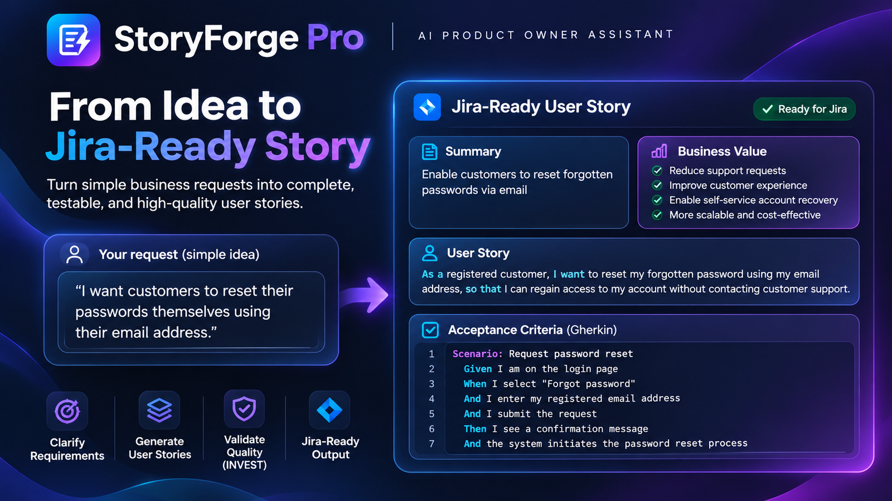
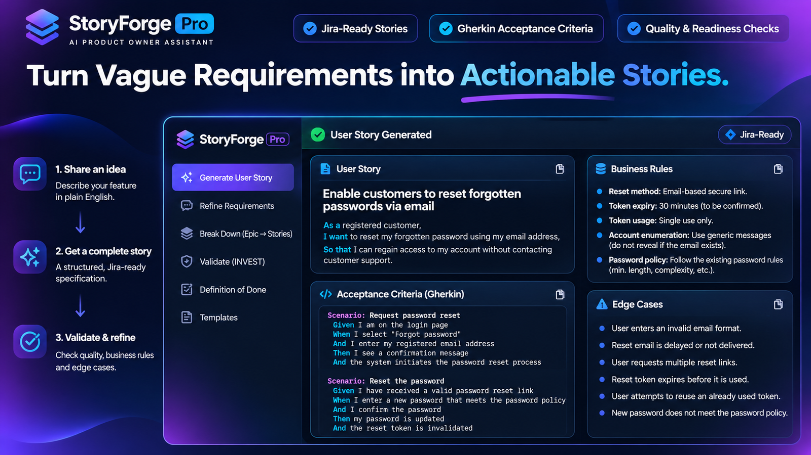
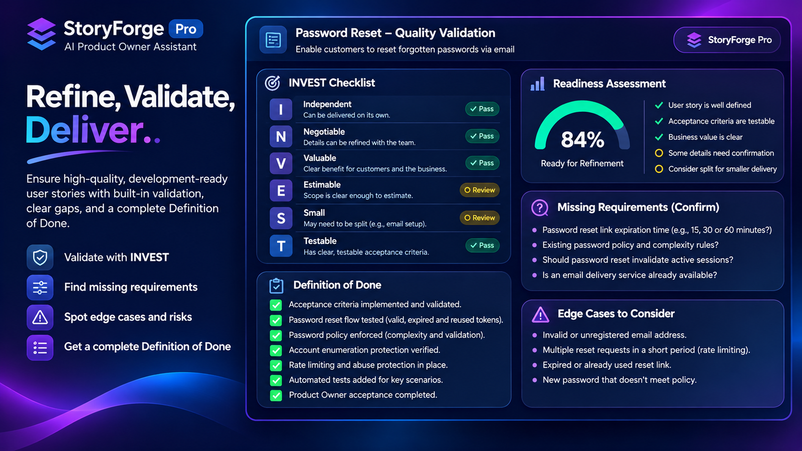

# StoryForge Pro — AI Product Owner Assistant

**Turn rough product ideas into clear, testable, Jira-ready user stories.**

StoryForge Pro is an installable AI-agent skill for Product Owners, Business Analysts, founders and delivery teams. It guides clarification, proposes structured backlog artifacts, drafts Gherkin acceptance criteria, checks INVEST quality and identifies unresolved decisions.

> **This is the public documentation repository, not the paid skill package.** The full `SKILL.md`, references and templates are distributed through the authorized marketplace listing after purchase. The images are illustrative mockups, not screenshots of a standalone StoryForge application or verified live-agent sessions.

## Capabilities

- **Create:** Generate a Jira-ready user story with acceptance criteria and open questions.
- **Refine:** Improve an existing story without silently changing its meaning.
- **Break down:** Split a broad feature into independent, user-valued stories.
- **Audit:** Assess story quality against INVEST, call out ambiguity and readiness gaps.
- **Export:** Produce copy-ready Jira fields; with a suitable authorized connector, preview proposed issue changes before any write.

## Installation

1. Obtain the **StoryForge Pro** ZIP through the Agensi marketplace listing.
2. Extract the ZIP, preserving its directory structure (`SKILL.md`, `references/`, `templates/`, and `examples/`).
3. Follow your AI agent's supported SKILL.md installation method to install or register the extracted skill. The exact path and interface depend on your agent and version.
4. Ask your agent to use **StoryForge Pro** and provide a feature idea in plain English.

See [Installation and compatibility](docs/installation.md) for detailed guidance. No Jira account is required for text-only story generation.

## Quick start

Use a prompt such as:

> Use StoryForge Pro to turn this idea into a Jira-ready story: Customers need to download their invoices. Ask me only the most important clarification questions. Label assumptions and unresolved decisions. Include Gherkin scenarios and an INVEST assessment.

Other prompt examples:

- `Use StoryForge Pro to audit this draft story using INVEST. Explain gaps before revising it: [paste story]`
- `Use StoryForge Pro to split this epic into small vertical stories: [describe the feature]`
- `Use StoryForge Pro to prepare a Jira issue preview. Do not create or update anything yet.`

## Example outputs

The skill can generate a story title, persona/value statement, acceptance criteria, business rules, edge cases, an INVEST review, Definition of Done suggestions and Product Owner questions. It does **not** invent company policies, story points, priorities or project-specific Jira fields. See [Example walkthrough](docs/example.md).

## Compatibility & permissions

- Runs as a text-based skill in AI agents that support the packaged `SKILL.md` format. Exact compatibility depends on each agent and its skill-loading mechanism.
- The core workflow requires no terminal, API keys, Jira credentials or external services.
- Optional Jira/Confluence reading or writing requires an authorized connector provided by the host agent.
- Before creating or updating external issues/pages, the skill should show a preview and obtain explicit approval.

## Documentation

- [Installation and compatibility](docs/installation.md)
- [Usage guide](docs/usage.md)
- [Password-reset example](docs/example.md)
- [FAQ and troubleshooting](docs/faq.md)

## Marketplace & support

Creator: [Bruno Garcia](https://www.agensi.io/creators/bruno-garcia).

The paid skill is distributed separately through Agensi. This repository contains public documentation and marketing images only. No secret keys, customer data, private code, or paid skill contents are included.

## License

Documentation and artwork copyright © 2026 Bruno Garcia. All rights reserved. The paid skill is distributed under the terms provided with its authorized purchase. This repository does not grant redistribution rights for the paid skill.
